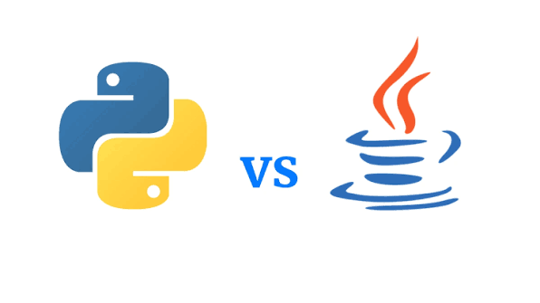

# Python Fundamentals for a Java Developer

I'm an experienced Java developer with about 2 years of independant work in Spring Boot, and I have products of my own, including [Applikon](https://aplikujbezspiny.pl), a job application tracker in production. 

## Why Python

With a background in professional work, I chose to study Computer Science at the Cracow University of Economics to strengthen my technical foundations - something I consider essential in the age of AI. Python is the language of my first-semester course, Fundamentals of Programming, and aligns with my interests in data and automation.

I come from Java, so I already know object-oriented design. What's new for me in Python is its syntax and idioms: dynamic typing, indentation as structure, `with` blocks, list comprehensions, and duck typing. Comparing these with Java is how I learn them.

## Where to find me

- GitHub: [github.com/jakubBone](https://github.com/jakubBone)
- LinkedIn: [linkedin.com/in/jakub-bone](https://linkedin.com/in/jakub-bone)
